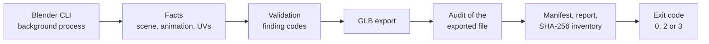

# Automotive content pipeline

Engineering CAD is exact and heavy. It's organised for manufacturing and was never meant for a headset that renders every frame twice. This page covers the geometry processing and tooling that turn it into content for the application described in [Automotive XR on Apple Vision Pro](https://github.com/jacobemanuel/automotive-spatial-visualization-portfolio). That means integrating a CAD SDK safely, computational geometry on CAD surfaces, collision proxies and porting the team's Blender add-on across API generations. Plus a deterministic, validating exporter.

The images are example assets made for illustration. They aren't OEM designs and there's no vehicle data in them.

| Stack | Formats and standards |
|---|---|
| Python (bpy, NumPy), C# (Unity Editor), Asset Transformer SDK (Pixyz), Blender 3.6 to 5.x, Unity 6.3, Shader Graph, PolySpatial / RealityKit | FBX, glTF, JSON Schema, SHA-256 manifests, ASTC |

## Integrating a CAD SDK without destabilising the project

An earlier attempt to add the tessellation toolkit left the editor crashing, most often when the project was reopened. I ran the integration on an isolated branch over a copy-on-write clone of the project. I only merged after a reopen test and a headless compile passed. The dependency diff stayed confined to the toolkit. The crashes were attributed to known macOS issues in the older toolkit and went away after the editor and the toolkit were upgraded together. A separate out-of-memory kill on the headset was traced to unoptimised raw CAD.

*Status: merged and in use.*

## Quilting cut into CAD surfaces

The quilted design and the CAD seat surfaces never line up. Replacing the CAD with a stylised seat would throw the engineering geometry away. So the quilting gets cut into the CAD mesh itself:

- The CAD keeps its own two-tone split.
- Each point takes the nearest design panel of the same tone.
- Triangles are split exactly along the panel borders so the new edges lie on the design lines.
- An earlier distance cut-off was removed because it left islands of fallback panels.

*Status: checked in the Editor and in an installed build. Approved in my check on the headset.*

## Stitches as geometry

Half a metre from the eye, a stitch printed into a texture looks flat. So each stitch is generated as an 18-vertex thread at the original stitch's position, direction and length. That gives the seams real depth.

## Collision proxies that stay out of the input system

Interactive props need collision but CAD meshes make poor colliders. 138,254 triangles of unneeded CAD colliders were replaced by 30 fitted primitives, checked with ray and penetration tests. There are four mesh colliders left. The primitives sit on a layer that PolySpatial doesn't sync, so they never become look-and-pinch targets.

## A Blender add-on across three API generations

The team's preparation add-on names parts for the Unity importer. It also carries materials across and handles the export. I ported it from Blender 3.6 to 5.x, where it's in daily use. The port involved:

- A configuration-driven naming grammar for interactive parts (components, clips, buttons, screens) that the importer parses.
- Animation reading for both legacy and slotted actions.
- Validation before export, with blocking errors and warnings. The export itself runs in a background process.
- Material values from Substance and the Principled BSDF get written to per-material preset JSON. A Unity-side assigner then applies them.

Altogether that's 17 operators. The minimum supported version moved from 3.6 to 4.0 and then 5.1.

## Silent data loss, made visible

Several export paths lose data without raising an error: FBX drops shape-key animation, muted NLA tracks still export, clips get cut at the frame range and ambient occlusion disappears unless it's wired through the glTF output group. The prototype exporter below turned these into validator findings. Shape-key animation through FBX is still unsolved.

## A deterministic, validating exporter

For an architecture exploration I designed and built a stricter exporter as a prototype.

- 12 modules and a command-line mode, with 112 finding codes.
- The command line returns 0 for a clean package, 2 for content errors and 3 for a crash. It's ready for batch runs.
- The audit reads the exported file back instead of trusting the scene. Nodes and animations are checked as they were written.
- Reported at build time: 7 JSON schemas, 44 tests over 154 test vectors, 14 checks inside Blender and two runs that produced a byte-identical 21-file package. Rigid-bone preparation drifted by at most 1.2 × 10⁻⁷ m.

*Status: prototype.*

## Environment lighting and texture memory

8K environment panoramas get compressed to ASTC 6×6 and swapped in place. Image-based lighting hangs off the parent of every vehicle so whichever vehicle is loaded gets lit by the selected environment. The scene's panoramas were consolidated from 11 to 4. That's about 140 MB less at load.

## How I work

I own the architecture, the requirements and the acceptance criteria. I build with AI coding tools and I review and integrate every change myself. I also tune the scenes and judge the result on the headset.

## Related

- [Automotive XR on Apple Vision Pro](https://github.com/jacobemanuel/automotive-spatial-visualization-portfolio): rendering, interaction and release engineering of the application.

The environment presets use CC0 HDRIs from Poly Haven that come bundled with Blender. Employer, vehicle and internal tool names are left out.

© 2026 Jakub Majewski. Text and media: all rights reserved.
