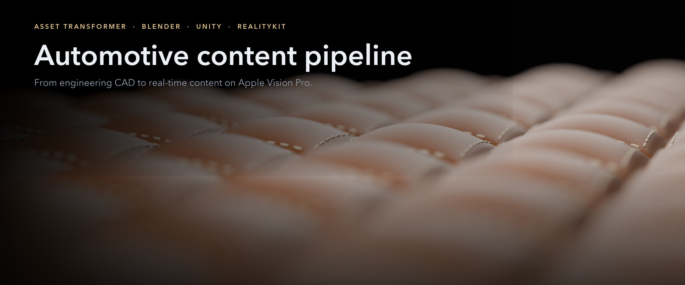
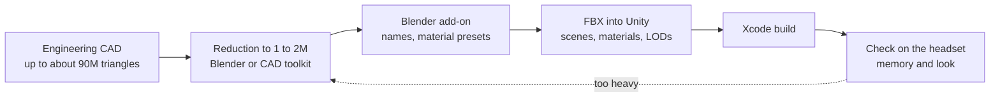
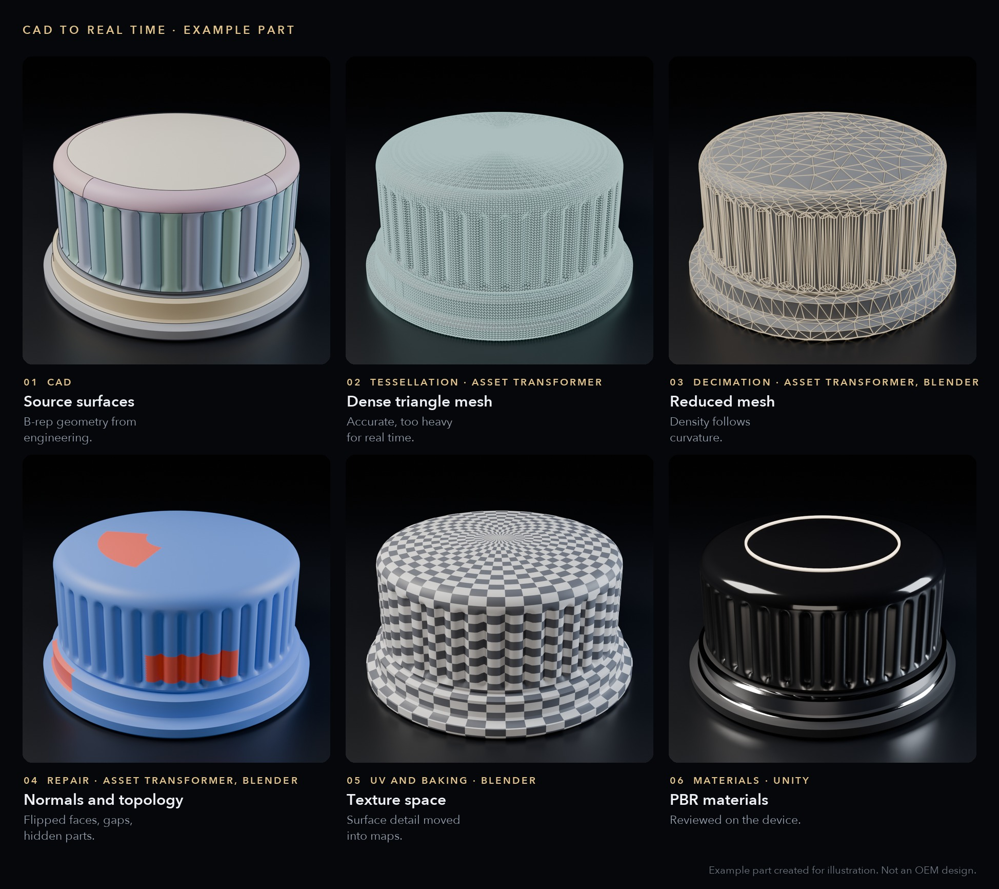
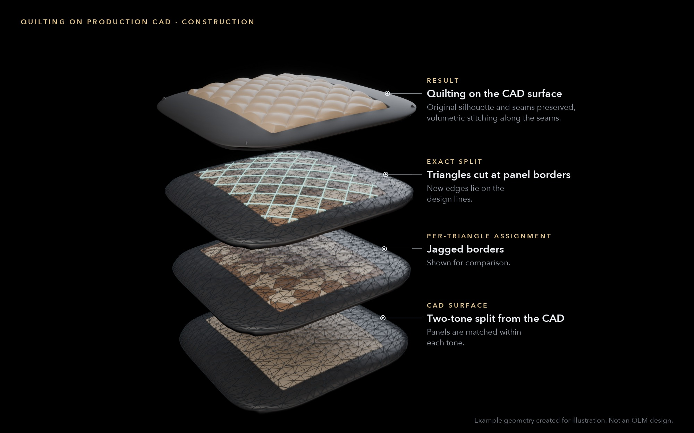
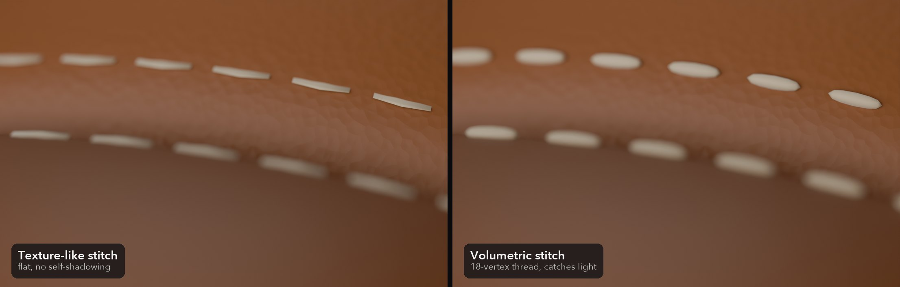
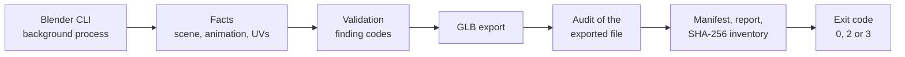
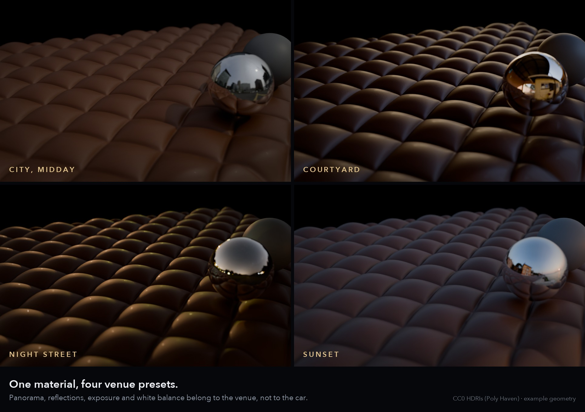

# Automotive content pipeline

The workflow and tools that take car interiors from engineering CAD to the headset for the [Automotive XR](https://github.com/jacobemanuel/automotive-spatial-visualization-portfolio) app. Trim gets fitted from reference photos and the measured geometry, in millimetres, starting with the seats. A written guide makes the same look repeatable on other cars. A measurement pipeline shows what the mesh reductions save, and the team's Blender add-on prepares the models for export.

The images are example assets made for illustration. They aren't designs from any car maker and there's no vehicle data in them.

| Stack | Formats and standards |
|---|---|
| Python (bpy, NumPy), C# (Unity Editor), Unity Asset Transformer SDK (Pixyz), Blender 3.6 to 5.x, Unity 6.3, Shader Graph, PolySpatial / RealityKit | FBX, glTF, HDRI, JSON Schema, SHA-256 manifests, ASTC |

## From CAD to the headset

Engineering CAD arrives with up to about 90 million triangles and gets reduced to 1 to 2 million, by hand in Blender or with a CAD toolkit. The team's Blender add-on names the parts and carries the materials across. The exported FBX goes into the Unity scenes, and every build gets checked on the headset. When a build runs out of memory, the model goes back to the reduction step.

## Trim fitted from photos, in millimetres

Reference photos show the quilting and stitching, and the meshes have the real sizes. I built a workflow that fits one to the other. The seats came first, so the steps below describe them, and the same steps work on any other part:

1. The photos give the layout of the pattern and the seat meshes give the measured bounds. A parametric generator draws the pattern from both, in millimetres.
2. The texture layout (UVs) is scaled from the measured bounds, front and rear seats separately, so a stitch has the same physical size on all four seats. Mirrored seats get their tangent handedness corrected, so the baked relief isn't lit from the wrong side.
3. The depth of the quilting is baked from a height field into normals on the low-poly seat. Colour is composed in linear space with a stitch mask, and metallic and smoothness are packed into one map.
4. The maps go into Unity with the right colour-space and normal-map settings.

The photos only set the layout, and every size comes from the measured seat. The detail keeps its physical scale while the seat meshes get much lighter (numbers below).

## A guide for the next car

I wrote the workflow up as a 25-page guide to reproducing the materials and details, with a recipe kit, so the same look can be rebuilt on another car without starting from zero.

## Measuring the result

A measurement pipeline counts renderers, triangles, vertices and submeshes per group straight from the Unity scene, along with textures and texel density. It renders before-and-after views from the same camera with the collider boxes drawn in. Then it writes charts and tables and records the measurement rules it used. For the full review build:

- **Seats:** from about 705k to 210k triangles, about 70% fewer.
- **Whole car:** from about 1.8 million to 1.0 million triangles.
- **Materials:** 16 seat material slots moved onto one Shader Graph.
- **Environments:** panoramas consolidated from 11 to 4, about 140 MB less at load.

After that, six level-of-detail (LOD) passes went into the final build.

## Quilting cut into CAD surfaces

The quilted design and the CAD seat surfaces never line up. Replacing the CAD with a stylised seat would throw the engineering geometry away. So the quilting gets cut into the CAD mesh itself:

- The CAD keeps its own two-tone split.
- Each point takes the nearest design panel of the same tone.
- Triangles are split exactly along the panel borders so the new edges lie on the design lines.
- An earlier distance cut-off was removed because it left islands of fallback panels.

*Status: checked in the Editor and in an installed build. Approved in my check on the headset.*

## Stitches with real depth

Half a metre from the eye, a stitch printed into a texture looks flat. On the dashboard top, the front door panels, the console and the steering wheel, each stitch is an 18-vertex thread at the original stitch's position, direction and length, which gives the seams real depth. The stitch paths get projected onto the leather with ray casts. On the seats the stitches stay in the baked maps, which keeps the seat meshes light.

## The team's Blender add-on

The add-on gets designers' Blender scenes ready for the Unity importer. A colleague wrote version 1.0.0. I took it over with his role in October 2025, and since then I've released eight versions, from 1.0.1 to the current 1.1.0, including the port from Blender 3.6 to 5.x. It's in daily use. What it does now:

- A configuration-driven naming grammar for interactive parts (components, clips, buttons, screens) that the importer parses.
- Animation reading for both legacy and slotted actions.
- Validation before export, with blocking errors and warnings. The export itself runs in a background process.
- Material values from Substance and the Principled BSDF get written to per-material preset JSON. A Unity-side assigner then applies them.

Altogether that's 17 operators (commands in Blender). The minimum supported version moved from 3.6 to 4.0 and then 5.1.

## CAD cleanup with a toolkit

Some parts go through a CAD toolkit, Unity Asset Transformer (Pixyz), for repair, normals, decimation and UVs in batches. An earlier test had crashed the Editor when the project was reopened. So I added the toolkit in July 2026, after the planned engine upgrade, on an isolated branch, and only merged it after a reopen test and a headless compile passed. With the newer engine and toolkit versions the crash was gone.

## Collision proxies that stay out of the input system

Interactive props need collision, but CAD meshes make poor colliders. Unneeded CAD colliders with 138,254 triangles were replaced by 30 fitted primitives and checked with ray and penetration tests. Four mesh colliders are left. The primitives sit on a layer that PolySpatial doesn't sync, so they never become look-and-pinch targets.

## Export paths that fail silently

Several export paths get the data wrong without raising an error: FBX drops shape-key animation, muted NLA tracks still export, clips get cut at the frame range and ambient occlusion disappears unless it's wired through the glTF output group. The prototype exporter below turned these into validator findings. Shape-key animation through FBX is still unsolved.

## A deterministic, validating exporter

For an architecture exploration I designed and built a stricter exporter as a prototype.

- 12 modules and a command-line mode, with 112 finding codes.
- The command line returns 0 for a clean package, 2 for content errors and 3 for a crash. It's ready for batch runs.
- The audit reads the exported file back and checks nodes and animations as they were written.
- Reported at build time: 7 JSON schemas, 44 tests over 154 test vectors, 14 checks inside Blender and two runs that produced a byte-identical 21-file package. Rigid-bone preparation drifted by at most 1.2 × 10⁻⁷ m.

*Status: prototype.*

## Environment lighting and texture memory

8K environment panoramas get compressed to ASTC 6×6 and swapped in place. Image-based lighting hangs off the parent of every vehicle, so whichever vehicle is loaded gets lit by the selected environment.

## How I work

I own the architecture and set the requirements and acceptance criteria. I build with AI coding tools and agents, and I review and integrate every change myself. I ran the toolkit and LOD passes and tuned the scenes, and I judged every result on the headset.

## Related

- [Automotive XR](https://github.com/jacobemanuel/automotive-spatial-visualization-portfolio): the app these interiors are made for, with its rendering, interaction, physics and release engineering.

The environment presets use CC0 HDRIs from Poly Haven that come bundled with Blender. Employer, vehicle and internal tool names are left out.

© 2026 Jakub Majewski. Text and media: all rights reserved.
